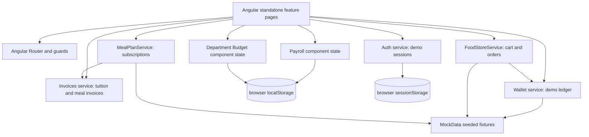
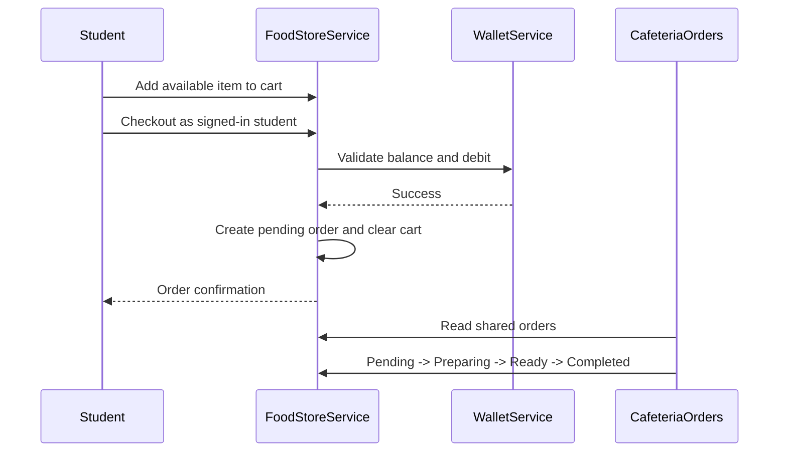
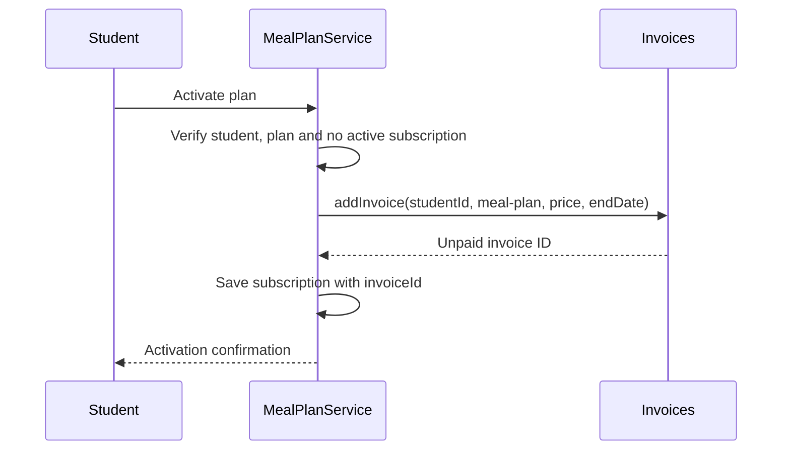

# Architecture and Technical Design

## 1. Goal and scope

Campus Finance demonstrates university financial services and cafeteria workflows in a **single Angular application**. The emphasis is on component organization, TypeScript models, client-side workflows, validation, route guards, and tested interactions. It is an academic **frontend mock**, not a distributed production application.

## 2. Technology stack

| Layer | Implementation |
| --- | --- |
| Presentation | Angular 22 standalone components, lazy-loaded routes |
| State and interaction | Angular signals for some shared state; services and component state elsewhere |
| Forms | Angular forms / reactive forms and local validation |
| Styling | Tailwind CSS v4, SCSS |
| Visualization | Chart.js for Department Budget |
| Data | MockData fixtures, in-memory services, localStorage for Payroll/Budget |
| Session | Auth service with sessionStorage (demo only) |
| Testing | Jasmine and Karma, Chrome |
| Build | Angular CLI / `@angular/build` |

No API server, relational database or external payment processor is implemented.

## 3. High-level architecture

## 4. Core modules

- **Auth** (`core/services/auth.ts`): exposes `currentUser` as an Angular signal, supports four seeded role-based demo logins and temporary student signups, and restores session state from `sessionStorage`.
- **Guards** (`core/guards/auth.guard.ts`): restrict authenticated routes and role-specific routes. They are client-side UX checks only.
- **Invoices** (`core/services/invoices.ts`): signal-backed mock invoices and payment history; validates invoice creation; `markAsPaid` adds a demo payment record and avoids paying an already-paid invoice twice.
- **WalletService** (`core/services/wallet.service.ts`): seeded student wallets, demo top-ups, debits, and transaction logs.
- **FoodStoreService** (`core/services/food-store.service.ts`): menu, cart, checkout, and a shared in-memory order ledger. A successful checkout deducts a mock wallet balance, creates an order, and clears the cart. Status transitions are enforced in sequence.
- **MealPlanService** (`core/services/meal-plan.service.ts`): manages active subscriptions, prevents concurrent active subscriptions, and creates a corresponding unpaid invoice via Invoices.
- **Payroll / Department Budget**: UI components use `localStorage` for demonstration records; budget charts use Chart.js.

## 5. Core entities (TypeScript models)

| Model | Key fields |
| --- | --- |
| User | `id`, `fullName`, `email`, `role` |
| Invoice | `id`, `studentId`, `type`, `description`, `amount`, `dueDate`, `status` |
| PaymentRecord | invoice reference, student, amount, timestamp, recorder and demo payment method |
| Wallet | `id`, `studentId`, `balance` |
| WalletTransaction | `id`, `walletId`, `type`, `amount`, `date`, `description` |
| FoodItem | `id`, `name`, `category`, `price`, `available` |
| FoodOrder | `id`, `studentId`, `items`, `totalAmount`, `status`, `createdAt` |
| MealPlan | `id`, `name`, `price`, `durationDays`, `mealsIncluded` |
| MealSubscription | `id`, `studentId`, `mealPlanId`, dates, `invoiceId` |
| Employee / PayrollRecord | base salary, monthly allowance, deductions and calculated net salary |
| FinancialRecord | type, category, amount, date and description |

**Relations (conceptual)**: one student may have many invoices, wallet transactions, orders and subscriptions; a subscription references an invoice; an order contains menu items; payroll records reference employees. These are TypeScript object relationships rather than database foreign keys.

## 6. Key interactions

### Food ordering

The order data exists in one shared service instance during application use, **not** in an API or durable datastore. Full reload resets it. The current cancel action does not implement refund logic.

### Meal plan and invoice

### Student fees

Students are scoped to invoices and payment records matching their current user ID. Accounting and Admin roles can view/manage mock invoice records. `markAsPaid` records a demo payment; there is no actual bank transaction.

## 7. Route access summary

| Path | Access |
| --- | --- |
| `/` | Home (role-aware links) |
| `/login`, `/signup` | Public |
| `/profile` | Authenticated |
| `/student-fees` | Student, Accounting, Admin |
| `/wallet`, `/food-ordering`, `/meal-plans` | Student |
| `/payroll`, `/department-budget` | Accounting, Admin |
| `/cafeteria-orders` | Cafeteria Staff, Admin |

## 8. Trade-offs and future work

The MVP favors an easy-to-demo frontend over infrastructure complexity. Production expansion would need: an API/backend, authenticated server sessions, hashed password handling, a relational database, atomic checkout and payment transactions, role authorization on each API operation, durable order history, wallet creation for registered students, actual invoicing/payment integrations, secure auditing, refunds, and end-to-end tests.
